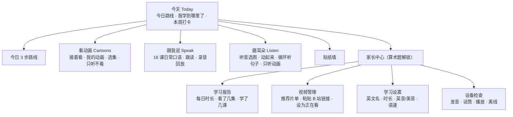

# 小耳朵英语 · 网站搭建方案

> 给一年级零基础孩子用的家庭英语网站：**以看动画为主，每天 15 分钟，多听、多说**。
> 本文是搭建思路，配套的可运行原型就在本仓库根目录（`index.html`）。

---

## 1. 背景与目标

### 1.1 孩子画像

| 维度 | 现状 | 对网站的要求 |
|---|---|---|
| 年龄 | 6 岁半，小学一年级 | 注意力 10–15 分钟，单个活动控制在 3–8 分钟 |
| 英语基础 | 一年级前零接触，没有语言环境 | 先大量听懂，再慢慢开口 |
| 识字 | 中文、英文都还在起步阶段 | **孩子不需要识字也能用**：图片 + 声音 + 大按钮 |
| 已经在学 | 学校英语 + 机构剑桥 Power Up | **家里不重复机构内容**，补机构给不了的：大量有趣的视频输入和日常口语 |
| 痛点 | 理解弱、口语少 | 多看动画（听懂）、多跟说（开口）、多磨耳朵（熟悉声音） |

### 1.2 目标

| 阶段 | 目标 |
|---|---|
| 第 1 个月 | 养成每天 15 分钟习惯；能跟唱 5–10 首英文儿歌；能说出「跟我说」前 4 课的句子 |
| 第 3 个月 | 能看懂 Maisy、Peppa Pig 这类简单动画的大意；能用 30 句左右的日常口语做简单问答 |
| 第 6 个月 | 能连续看 15 分钟英文动画不喊无聊；学完「跟我说」16 课，日常生活里愿意主动说英语 |

---

## 2. 设计原则

1. **看动画为主。** 6 岁孩子学语言最有效的方式是大量「听得懂、喜欢看」的输入。每天路线的第一步就是看一集动画，占一半时间。
2. **不重复机构课程。** 机构负责系统的单词和语法；家里负责「多听、多看、多说」，内容按生活场景编排，不跟任何教材走。
3. **不打分，只看进度。** 没有对错评分、没有家长打星。孩子能清楚看到：动画看到第几集、跟我说学到第几课、磨耳朵玩到第几关。每完成一项得一颗星，完成一天得一张贴纸。
4. **孩子不识字也能用。** 所有指令用图标 + 语音；所有英文都能点一下就发音（点读）。
5. **小步快跑。** 每天 3 步：看一集 → 说一课 → 听一关，大约 15 分钟。
6. **护眼。** 动画可以「只听不看」（挡住画面，声音继续）；到了设定时长会提醒休息。
7. **家长选片。** 视频由家长从推荐片单里挑、在家长中心添加，孩子只看家长加过的内容，不会跳到其他视频。

---

## 3. 每日学习路线（约 15 分钟）

| 顺序 | 环节 | 时长 | 做什么 | 孩子看到的进度 |
|---|---|---|---|---|
| 1 | 看动画 Cartoon | 约 8 分钟 | 接着上次看的系列，播放下一集；看完点「看完了」 | 「Peppa Pig 已看完 6 / 52 集」，选集里看完的打勾 |
| 2 | 跟我说 Say It | 约 4 分钟 | 学下一课的 3–4 句日常口语：先听，再跟着说，可以录音听自己的声音 | 「已学 3 / 16 课」，课程表里学完的打勾 |
| 3 | 磨耳朵 Listen | 约 3 分钟 | 听音选图一关（6 题，听到单词点图片） | 「听音选图第 5 关」 |
| 完成 | 贴纸 | — | 得到一张动物贴纸，连续天数 +1 | 贴纸墙、本周打卡 |

**家长配合建议：**
- 前两周陪孩子一起看、一起说，之后逐步放手。
- 同一集动画可以连着看几天，第一遍用中文讲讲情节，之后只放英文。
- 吃饭、搭积木的时候打开「磨耳朵 → 循环听句子」或「只听动画」当背景声。

---

## 4. 功能结构



### 4.1 孩子端（底部 4 个大图标）

| 分栏 | 内容 |
|---|---|
| **今天** | 今日 3 步路线（每步写着「接下来」是什么）、我学到哪里了（每个动画系列的进度条、16 课的格子、磨耳朵关数）、本周打卡 |
| **看动画** | 「接着看」大卡片；我的动画（家长加过的系列，带进度）；选集页（看完的打勾、下一集高亮）；播放页（看完了 / 只听不看 / 选集条）；给家长看的推荐片单 |
| **跟我说** | 16 课课程表（学完打勾、下一课高亮）；每课 3–4 句：问答（先听问题再回答）或跟读；点读、慢速、录音回放；不打分，说完就鼓励 |
| **磨耳朵** | 听音选图（一关一个主题，逐关前进）；动起来（听指令做动作）；循环听句子（学过的句子一遍遍放）；只听动画（挡住画面放当前动画） |

### 4.2 家长端

| 模块 | 内容 |
|---|---|
| 学习报告 | 最近 7 天每天学了多久、看了几集、学了几课；每个动画系列看到哪里；16 课完成情况 |
| 视频管理 | 按阶段排好的推荐片单；每个系列粘贴 B 站链接（合集只要一个链接 + 总集数），也可以填自己服务器上的 mp4；可以自己加片单以外的系列；「设为正在看」决定今日路线播哪个 |
| 学习设置 | 孩子英文名和年龄（用于 *My name is … / I'm six.*）、每日时长、英音/美音、发音人、语速、是否显示中文意思 |
| 设备检查 | 英语发音、话筒、动画播放、离线缓存、进度保存、桌面图标 |

---

## 5. 视频课程规划

### 5.1 推荐片单（适合 6–7 岁零基础，按顺序推进）

| 阶段 | 系列 | 口音 | 为什么选 |
|---|---|---|---|
| **入门**（第 1–2 月）儿歌和小对话 | Super Simple Songs | 美音 | 儿歌配动作，旋律简单、重复多，零基础最轻松 |
| | Steve and Maggie | 英音 | 英国老师和喜鹊玩偶，专为非英语国家的小朋友设计，互动提问多 |
| | English Singsing | 美音 | 一集一个 1–3 分钟的生活小对话，看完最适合跟着说 |
| | Maisy Mouse 小鼠波波 | 英音 | 画面简单、语速慢、句子极短 |
| **进阶**（第 2–4 月）生活动画和自然拼读 | Peppa Pig 小猪佩奇（英文版） | 英音 | 家里、幼儿园、公园的日常，句子都很常用 |
| | Alphablocks 字母积木 | 英音 | BBC 出品，字母发音和拼读，配合学校学字母 |
| | Numberblocks 数字积木 | 英音 | BBC 出品，英文数数和简单数学 |
| | Sarah & Duck 莎拉和乖乖鸭 | 英音 | 节奏慢、对白少而清楚 |
| **提高**（第 4 月起）系统课程和更长的动画 | Muzzy（BBC 英语动画课） | 英音 | BBC 为外语学习者做的经典动画课程，有 5–7 岁版本 |
| | Gogo Loves English | 美音 | 配套教材的系统动画课，每集一个主题，句型由浅入深 |
| | Hey Duggee 嗨道奇 | 英音 | 剧情有趣，语速稍快 |
| | Bluey 布鲁伊 | 澳式 | 很好看，语速较快，适合学了半年以后 |

另可考虑付费的分级动画 App（如 Little Fox，按级别编排的动画故事和儿歌），作为半年后的补充。

### 5.2 看动画的方法

1. **一次只追一个系列**，每天 1–2 集。孩子喜欢的那一集可以反复看。
2. **第一遍可以用中文讲情节**，之后只放英文，不开中文字幕。
3. **看完说一说**：挑一两句常用的话，和孩子角色扮演，或者到「跟我说」里练相近的句子。
4. **眼睛累了就「只听不看」**，把动画当成背景声。

### 5.3 视频来源和版权

- 网站**不存储视频**：B 站视频用 B 站自己的播放器嵌入播放；也可以填自己服务器上的 mp4（只放有合法来源的视频，并且不要公开网址）。
- 在 B 站选视频时，**优先选官方账号或有授权的上传**，选完整、清晰、不带奇怪剪辑的版本。
- Super Simple 官方帮助页面说明，国内可以在 UKids App 观看。
- 机构 Power Up 教材的音视频有版权，网站不放这些内容。

---

## 6. 跟我说：16 课日常口语（原创）

每课 3–4 句，按孩子的生活场景排列，不跟任何教材走：

| 课 | 主题 | 例句 |
|---|---|---|
| 1 | Hello! 打招呼 | What's your name? — My name is Tom. |
| 2 | How are you? 你好吗 | I'm fine, thank you. / I'm hungry. |
| 3 | How old are you? 你几岁 | I'm six. / How many cats? — Three cats. |
| 4 | What colour is it? 颜色 | It's red. / My favourite colour is blue. |
| 5 | What's this? 这是什么 | It's a dog. / The elephant is big. |
| 6 | My family 我的家人 | This is my mum. / I love my family. |
| 7 | I like apples 喜欢吃什么 | Do you like carrots? — No, I don't. |
| 8 | I've got a ball 我的玩具 | Have you got a teddy bear? — Yes, I have. |
| 9 | Touch your nose 身体 | Clap your hands! / I've got two eyes. |
| 10 | I can jump 我会做 | Can a bird fly? — Yes, it can. |
| 11 | Put on your shoes 穿衣服 | Put on your hat. |
| 12 | It's sunny 天气 | What's the weather like? — It's rainy. |
| 13 | Where's the cat? 在哪里 | It's on the bed. / It's under the chair. |
| 14 | At school 在学校 | Good morning, teacher! / Sit down, please. |
| 15 | Please and thank you 礼貌用语 | You're welcome. / I'm sorry. — That's OK. |
| 16 | Good night 早晚问候 | Brush your teeth. / It's time for bed. |

句子里的名字和年龄会换成家长设置的孩子英文名和年龄。内容在 `assets/js/data.js`，可以随时加课。

---

## 7. 磨耳朵

| 活动 | 做什么 | 进度 |
|---|---|---|
| 听音选图 | 听到单词，点对应的图片；一关 6 题，每关一个主题（问候、颜色、数字、动物、家人、身体、学校、玩具、食物、衣服、家），11 关一轮 | 第几关 |
| 动起来 | 听指令做动作（*Touch your nose! / Jump! / Turn around.*），适合学累了活动一下 | 做了几次 |
| 循环听句子 | 把学过的课的句子一句句读两遍，放完从头再来，可以当背景声 | — |
| 只听动画 | 播放「正在看」的动画，画面挡住只放声音 | 和看动画共用进度 |

---

## 8. 技术方案

### 8.1 原型（本仓库）：纯静态网页，零依赖

| 方面 | 做法 |
|---|---|
| 技术 | 原生 HTML + CSS + JavaScript，无需构建 |
| 设备 | 平板优先（华为平板、iPad 横竖屏），兼容手机和电脑；按钮最小 56px |
| 视频 | B 站外链播放器（`player.bilibili.com`，按 BV 号和集数播放）或 `<video>` 播放 mp4；「看完了」由孩子点按钮记录（B 站播放器无法告诉网站播完了），mp4 播完自动记录 |
| 发音 | 浏览器自带语音合成（`speechSynthesis`），默认英音，可调语速；朗读时逐词高亮 |
| 跟读 | `MediaRecorder` 录音并回放，不做识别、不打分 |
| 数据 | `localStorage` 保存进度和家长添加的视频链接（单设备） |
| 离线 | Service Worker 缓存网站本身，可「添加到桌面」；动画仍需联网 |
| 字体 | 本地字体文件，不依赖 Google Fonts |

### 8.2 国内网络与设备的注意点

| 问题 | 影响 | 处理 |
|---|---|---|
| 平板自带的英语发音参差不齐 | 跟我说、磨耳朵的朗读效果因设备而异 | 「设备检查」里试听；不理想时改为**预生成音频**（Azure / 讯飞等 TTS 一次性生成 mp3） |
| B 站外链播放器 | 可能出现「打开 App」之类的按钮；个别视频不允许外链 | 家长选片时先在「看动画」里试播 |
| GitHub Pages 在国内不稳定 | 首次打开可能慢 | 打开一次后网站缓存在平板上；正式版放自己的服务器 + 域名备案 |

### 8.3 正式版建议

| 层 | 推荐 | 说明 |
|---|---|---|
| 部署 | 自己的服务器或对象存储 + 域名备案 + HTTPS | HTTPS 是话筒和离线缓存的前提；`sw.js` 设为不缓存，保证能及时更新 |
| 音频 | 预生成 mp3 | 发音统一、离线可用 |
| 数据 | 轻量后端（微信云开发 / Supabase 等） | 多设备同步、家长在手机上管理视频 |
| 形态 | 先 PWA；想分享给其他家长再考虑微信小程序 | |

### 8.4 数据模型（原型已实现）

```text
settings  { name, age, dailyMinutes, accent, rate, voiceURI, showChinese }
videos    { lists: { <系列id>: { episodes: [{kind:'bili', bvid, page} | {kind:'file', src}], watched: [集序号] } },
            custom: [自定义系列], current: 正在看的系列 }
lessons   { <课id>: { done, n } }
games     { listen: 过了几关, move: 做了几次 }
days      { "YYYY-MM-DD": { secs, steps{}, done, log: { watched, lessons, games } } }
stars, stickers[]
```

---

## 9. 原型说明

| 页面 | 状态 |
|---|---|
| 今天（3 步路线、我学到哪里了、本周打卡、完成得贴纸） | ✅ 可用 |
| 看动画（接着看、我的动画、选集、播放、只听不看、推荐片单） | ✅ 可用（需家长先添加视频链接） |
| 跟我说（16 课、问答/跟读、点读、录音回放） | ✅ 可用 |
| 磨耳朵（听音选图、动起来、循环听句子、只听动画） | ✅ 可用 |
| 家长中心（报告、视频管理、设置、设备检查） | ✅ 可用 |
| 离线缓存 + 添加到桌面 | ✅ 可用 |
| 插画、预录音频、云同步 | ⏳ 正式版 |

**运行方式：** 见根目录 `README.md`；部署到华为学习平板见 [`deploy-huawei.md`](deploy-huawei.md)。

---

## 10. 迭代路线

| 版本 | 内容 |
|---|---|
| **原型 v0**（当前） | 家长添加 1–2 个系列的视频，自己先试用 1–2 周，观察孩子最喜欢哪个系列、哪个环节 |
| **v1 家庭版** | 部署到自己的服务器；视情况换成预录音频；按孩子喜好补充「跟我说」课程（比如跟着正在看的动画出句子）；统一插画 |
| **v2** | 云同步，家长在手机上管理视频和查看报告；自然拼读小游戏配合 Alphablocks |

---

## 11. 家长小贴士

- **固定时间点**：比如每天晚饭后 15 分钟，比「有空就学」更容易坚持。
- **允许孩子「只看不说」**：开口需要积累，前几周不说话也正常，继续看、继续听就行。
- **夸具体的事**：「你今天自己看完了一整集」「*elephant* 说得特别清楚」比「真棒」更有用。
- **把英语用到生活里**：吃饭时问 *Do you like carrots?*，出门时说 *Put on your shoes.*，这些都是「跟我说」里的句子。
