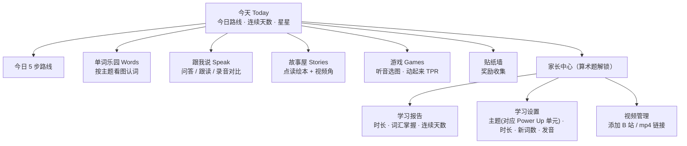

# 小耳朵英语 · 网站搭建方案

> 给一年级零基础孩子用的「每天 10–20 分钟听说」家庭英语网站。
> 本文是搭建思路，配套的可运行原型就在本仓库根目录（`index.html`）。

---

## 1. 背景与目标

### 1.1 孩子画像

| 维度 | 现状 | 对网站的要求 |
|---|---|---|
| 年龄 | 6 岁半，小学一年级 | 注意力 10–15 分钟，单个活动控制在 2–5 分钟 |
| 英语基础 | 一年级前零接触，无语言环境 | 从「听懂」开始，先大量输入，再要求输出 |
| 识字 | 中文、英文都还在起步阶段 | **孩子不需要识字也能用**：图片 + 声音 + 大按钮 |
| 正在学 | 学校英语 + 机构剑桥 Power Up | 内容与 Power Up 主题同步，作为课后复习和延伸 |
| 痛点 | 单词认知弱、口语少 | 重点做：认词、跟读、问答、听故事 |

### 1.2 目标（可衡量）

| 阶段 | 目标 |
|---|---|
| 第 1 个月 | 养成每天 15 分钟习惯；认识 60–80 个高频词（看图能说出来） |
| 第 3 个月 | 认识 200 个左右 Pre A1 Starters 核心词；能用 10 个以上句型做简单问答 |
| 第 6 个月 | 能看懂简单的英文动画片段（如 Peppa Pig）；能完整复述 4–6 句的小故事 |
| 1 年 | 词汇、听力、口语达到剑桥 Pre A1 Starters 水平 |

> Power Up 1–2 级大致对应剑桥 Pre A1 Starters 难度，所以网站的词表和句型以 Starters 考纲范围为骨架，家长再按机构当前单元勾选主题。

---

## 2. 设计原则

1. **输入先行，听说为主。** 6 岁孩子学母语也是先听 1–2 年才开口。网站每个环节都先「听」，再「跟着说」，最后「自己说」。
2. **小步快跑，每天 15 分钟。** 5 个小环节串成一条「今日路线」，每个 2–4 分钟，做完就收工，不拖时间。
3. **不识字也能用。** 所有指令用图标 + 语音；所有英文都能点一下就发音（点读）。
4. **与 Power Up 同步。** 家长在后台勾选「当前单元对应的主题」，新词和句型就从这些主题里出。
5. **科学复习。** 用间隔重复（1、2、4、7、15 天）安排旧词复习，孩子不用背，靠反复「遇见」记住。
6. **只奖励，不惩罚。** 答错只会「再听一遍」，没有扣分和红叉；星星、贴纸、连续天数做正反馈。
7. **家长是教练。** 录音评分不准时由家长打分；家长中心看报告、调设置、加视频。
8. **护眼与限时。** 达到当天设定时长后温柔提醒休息；视频单独限时。

---

## 3. 每日 15 分钟学习路线

| 顺序 | 环节 | 时长 | 做什么 | 训练点 |
|---|---|---|---|---|
| 1 | 复习热身 Warm-up | 2 分钟 | 系统挑出「今天该复习」的旧词，听一遍、说一遍 | 间隔重复，巩固记忆 |
| 2 | 新单词 New Words | 4 分钟 | 3–5 个新词：大图 + 发音（自动读 2 遍）+ 例句，点任意词可再听 | 认词、语音输入 |
| 3 | 跟我说 Say It | 4 分钟 | 2 个句型：问答式（App 提问、孩子回答）或跟读式；录音回放对比 | 口语输出、句型 |
| 4 | 故事时间 Story | 4 分钟 | 6 页小绘本，自动朗读并逐词高亮（指读），每页可跟读 | 连贯听力、语感 |
| 5 | 小游戏 Game | 2–3 分钟 | 听音选图 6 题，用今天的新词和复习词出题 | 检验听力辨词 |
| 完成 | 贴纸奖励 | — | 解锁一张动物贴纸，连续天数 +1 | 习惯养成 |

**家长建议的配合方式：**
- 前两周家长坐在旁边一起点、一起说，之后逐步放手。
- 视频不放进每日路线，作为「周末加餐」或者固定时间（如晚饭后 10 分钟）在「视频角」看。
- 机构上新单元当天，在家长中心把新主题勾上，第二天的新词就自动跟上。

---

## 4. 功能模块与信息架构



### 4.1 孩子端（底部 5 个大图标）

| 模块 | 关键功能 |
|---|---|
| **今天** | 今日路线（5 步打卡）、开始/继续按钮、今日时长进度、连续天数、本周打卡 |
| **单词乐园** | 11 个主题卡片（问候与心情、颜色、数字、动物、家人、身体、学校、玩具、食物、衣服、家）；单词卡：大图、正常/慢速发音、例句点读、跟读录音 |
| **跟我说** | 句型练习：问答模式（App 问，孩子答）与跟读模式；录音 → 回放 → 和原音对比；自动打星或家长打星 |
| **故事屋** | 原创小绘本，逐词高亮朗读、点词发音、自动翻页、每页跟读；**视频角**：推荐片单 + 家长添加的视频 |
| **游戏** | 听音选图（听单词选图片）；动起来 TPR（听指令做动作：Touch your nose! / Jump!） |

### 4.2 家长端

| 模块 | 关键功能 |
|---|---|
| 学习报告 | 本周每日学习时长、累计星星、已认识/已掌握单词数、各主题掌握进度 |
| 学习设置 | 孩子英文名和年龄（用于个性化句子 *My name is Tom. / I'm six.*）、每日时长（10/15/20 分钟）、每天新词数（3/5/8）、当前学习主题、英音/美音、语速、发音人、是否显示中文提示 |
| 视频管理 | 粘贴 B 站视频链接或 mp4 地址加入「视频角」 |
| 数据 | 重置进度（后续版本：导出/导入、多设备同步） |

---

## 5. 内容规划

### 5.1 词汇：按主题组织，对齐 Starters

原型内置 11 个主题、120 多个词，每个词包含：英文、中文提示、图片、例句。例句优先用 Power Up / Starters 阶段的高频句型（*It's a … / I like … / I've got … / This is my …*）。

| 主题 | 示例词 | 配套句型 |
|---|---|---|
| Hello & Feelings 问候与心情 | hello, good morning, thank you, happy, hungry | What's your name? How are you? |
| Colours 颜色 | red, blue, yellow, green, grey | What colour is it? It's red. |
| Numbers 数字 1–10 | one … ten | How many cats? Three cats. |
| Animals 动物 | cat, dog, elephant, giraffe | What's this? It's a dog. Can a bird fly? |
| Family 家人 | mum, dad, grandma, brother | Who's she? She's my mum. |
| My Body 身体 | head, eyes, nose, hand, foot | Touch your nose. I've got two eyes. |
| School 学校 | book, pencil, ruler, bag | Have you got a ruler? Yes, I have. |
| Toys 玩具 | ball, kite, robot, teddy bear | Where's the ball? It's under the chair. |
| Food 食物 | apple, banana, cake, milk | Do you like apples? Yes, I do. |
| Clothes 衣服 | hat, T-shirt, trousers, socks | Put on your shoes. |
| My Home 家 | bed, door, sofa, window | Where's the cat? It's on the bed. |

> 用词以英式英语为准（grey、favourite、trousers、mum），与剑桥教材一致；设置里可切换为美音发音。

**扩充方式：** 词库是一个纯数据文件（`assets/js/data.js`），家长或开发者可以按 Power Up 每个单元的词表直接添加。正式版建议做成家长后台可编辑。

### 5.2 故事：原创小绘本

- 每本 6 页，每页 1–2 句，复用当周主题词和句型（如 *Where's my cat? Is it on the bed? No!*）。
- 原型内置 6 本：*Hello, I'm Pip!*、*Where's My Cat?*、*Colour Parade*、*Lunch Time*、*Count the Ducks*、*Get Dressed, Max!*
- 原型用 emoji 充当插图；正式版需要统一风格的插画（可外包或用 AI 生成后人工挑选）。

### 5.3 视频：推荐片单（以英音、慢语速为主）

| 阶段 | 推荐 | 理由 |
|---|---|---|
| 入门（第 1–2 月） | **Maisy Mouse 小鼠波波**、**Super Simple Songs** | 画面简单、句子极短；儿歌配动作，适合磨耳朵 |
| 入门-初级（第 2–4 月） | **Peppa Pig 小猪佩奇**（英音）、**Sarah & Duck**、**Alphablocks 字母积木** | 家庭生活场景，句型和 Power Up 主题高度重合；Alphablocks 配合学校字母和自然拼读 |
| 初级（第 4 月起） | **Numberblocks**、**Hey Duggee**、**Ben and Holly's Little Kingdom** | 语速稍快、剧情更丰富 |

**看视频的方法（比看多少更重要）：**
1. 一集反复看一周：第 1 遍看懂情节（家长可用中文讲一下），之后只放英文。
2. 每集挑 2–3 句高频句，在「跟我说」里加成句型练习，或者和孩子角色扮演。
3. 平时把同一集的音频当背景声播放（「磨耳朵」）。

**版权说明：** Power Up 教材的音视频、课本插图有版权，网站**不托管**这些内容。家长自己购买的资源只在家庭内部使用；网站里的视频以「链接到正版平台（B 站官方号、国内视频平台正版专区）」的方式接入。

---

## 6. 关键技术方案

### 6.1 原型（本仓库）：纯静态网页，零依赖

| 方面 | 做法 |
|---|---|
| 技术 | 原生 HTML + CSS + JavaScript，无需构建，浏览器直接打开 `index.html` 即可 |
| 设备 | 平板优先（iPad 横竖屏），兼容手机和电脑；按钮最小 56px，适合小手 |
| 发音 | 浏览器自带语音合成（Web Speech API `speechSynthesis`），默认英音 en-GB，可调语速 |
| 跟读 | `MediaRecorder` 录音并回放；支持 `SpeechRecognition` 的浏览器自动识别打星，不支持时家长打星 |
| 逐词高亮 | 语音合成的 `boundary` 事件驱动；不支持时整句高亮 |
| 数据 | `localStorage` 保存进度（单设备） |
| 复习算法 | 5 级 Leitner 盒子：答对升一级，复习间隔 1 / 2 / 4 / 7 / 15 天；答错回到第 1 级 |

### 6.2 国内网络与设备的注意点

| 问题 | 影响 | 建议 |
|---|---|---|
| Chrome 的语音识别走 Google 服务器 | 国内 Chrome 上自动打星不可用 | 原型自动降级为「家长打星」；iPad Safari（iOS 14.5+）可用系统识别 |
| Chrome 的「Google UK English」发音人是在线语音 | 可能加载不到 | 原型会自动回退到系统自带英文发音人；iPad 上推荐 Daniel（英音）/ Samantha（美音） |
| 浏览器自带发音质量参差 | 不同设备听感不一致 | 正式版改为**预生成音频**：用 Azure TTS（如英音童声 en-GB-MaisieNeural）或讯飞 TTS 一次性生成全部 mp3 |
| Google Fonts 在国内可能无法加载 | 字体回退为系统字体 | 正式版把字体文件放到自己的服务器 |
| YouTube 不可用 | 视频需另找来源 | 视频角支持 B 站外链播放器和 mp4 地址 |

### 6.3 正式版建议的技术选型

| 层 | 推荐 | 说明 |
|---|---|---|
| 前端 | Vue 3 + Vite，做成 PWA（可添加到主屏幕、离线可用） | 家庭自用最省事；若想分享给其他家长，可改做**微信小程序**（uni-app 一套代码） |
| 音频 | 预生成 mp3 放 CDN（阿里云 OSS / 腾讯云 COS） | 发音统一、离线可缓存 |
| 口语评测 | 腾讯云「智聆口语评测」或讯飞「语音评测」 | 有针对少儿的单词/句子发音打分，国内可用 |
| 后端 | 轻量 BaaS（微信云开发 / LeanCloud / Supabase） | 账号、进度云同步、家长后台编辑词库 |
| 部署 | 静态托管（GitHub Pages 原型；正式版国内用 OSS + CDN 并备案） | |

### 6.4 数据模型（原型已实现）

```text
settings  { name, age, dailyMinutes, newPerDay, themes[], accent, rate, voiceURI, showChinese }
words     { "<theme>:<word>": { box, due, seen, right, wrong } }      ← 间隔重复
sentences { "<id>": { n, best } }                                        ← 句型练习次数和最高星
stories   { "<id>": { n } }
days      { "YYYY-MM-DD": { secs, stars, steps{}, plan{}, done } }    ← 每日计划与打卡
stars, stickers[], videos[]
```

---

## 7. 原型说明

| 页面 | 状态 |
|---|---|
| 今天（今日路线 + 5 步流程 + 完成奖励） | ✅ 可用 |
| 单词乐园（主题 → 单词卡 → 发音/例句/跟读） | ✅ 可用 |
| 跟我说（问答/跟读、录音回放、自动或家长打星） | ✅ 可用 |
| 故事屋（逐词高亮朗读、点读、自动翻页、跟读） | ✅ 可用 |
| 视频角（推荐片单、B 站/mp4 链接播放） | ✅ 可用 |
| 游戏（听音选图、动起来 TPR） | ✅ 可用 |
| 贴纸墙 | ✅ 可用 |
| 家长中心（报告、设置、视频管理、重置） | ✅ 可用 |
| 插画、预录音频、云同步、口语评测 API | ⏳ 正式版 |

**运行方式：** 见根目录 `README.md`。

---

## 8. 迭代路线

| 版本 | 时间 | 内容 |
|---|---|---|
| **原型 v0**（当前） | 第 1 周 | 跑通每日路线；家长先自己试用 1–2 周，观察孩子最喜欢 / 最抗拒哪个环节 |
| **v1 家庭版** | 第 2–4 周 | 按 Power Up 实际单元补全词表；预生成全部音频；统一插画；PWA 离线；家长后台编辑词库 |
| **v2 增强版** | 第 2–3 月 | 接入口语评测 API；自然拼读（Phonics）模块配合学校字母进度；更多绘本（每周 1–2 本） |
| **v3 分享版**（可选） | 之后 | 账号 + 云同步；做成微信小程序，开放给班级其他家长 |

---

## 9. 家长使用小贴士

- **固定时间点**：比如每天晚饭后 15 分钟，比「有空就学」更容易坚持。
- **允许孩子「只听不说」**：开口需要积累，前几周不说话也正常，继续听就行。
- **多夸具体的点**：「你刚才 *elephant* 说得特别清楚」比「真棒」更有用。
- **把英语用到生活里**：吃饭时问 *Do you like carrots?*，穿衣服时说 *Put on your socks.*——网站里的句型就是为这些场景选的。
- **和机构老师沟通**：每单元的词表、歌曲拿到后加进网站，课上学、家里复习，效果最好。
